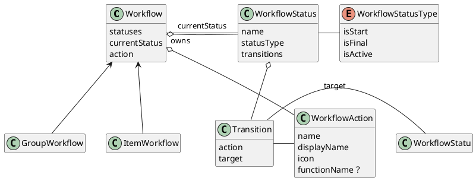
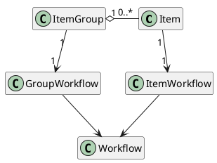

# Diagram

## workflow




## ItemGroup



# description

## workflow

workflow is the parent of item workflow and item group workflow

workflow owns 1 to more status
workflow owns 1 to more actions
status owns 1 to more transitions
transtion belongs to 1 status
transtion has one action, once action is triggered, workflow will transition to target status. action must be one of actions of workflow, so, when workflow is in a give status, all allowed actions are actions of its transition

each status must be in a give WorkflowStatusType. 
workflow must have at least isStart type status, and at least isFinal type status

now, we may not be able to create user customized workflow action, so we should define some functions, and map workflow actions to thse functions, like Complete, Start, Switch, Forward, Backward, Cancel.
so, we have a list of predefined actions. action in transition must choose from the list, and target stasut must choose from status list of the workflow

## item group

assume we have 2 level of item groups, level 1 is the level which is nearest items, it means it contains items.level2 is the parent of level1, and so on. for example: sprint is level1, epic is level2.

3 cases:
### 2 levels

we have 2 levels item groups, like Epic -> Sprint, or 期 -> 主题, 
for example for we a demo data:
level2 item groups:
```
Epic 26-2
Epic 26-3
Epic 26-4
```

now, epic 26-3 is an active epic, means it's neither isStart now isFinal, but isActive. and Epic 26-2 is Done, Epic 26-4 is Todo

I'd like to show Epic 26-2, 26-3 and 26-4 in Side directly


### 1 levels

just like current situation: we have sprint level only. the difference is: currently sprint is hardcoded, and we have SprintService and SprintController, which I said we should remove before.
Now, all business logical will be at ItemGroupService/ItemGroupController, but 'Sprint' is the name of ItemGroup, 'Start Sprint' and 'Complete Sprint' are name of action, they're configured, not hardcoded.

in sidebar, Epic block will be removed. 

### no itemGroup

I need think over again.