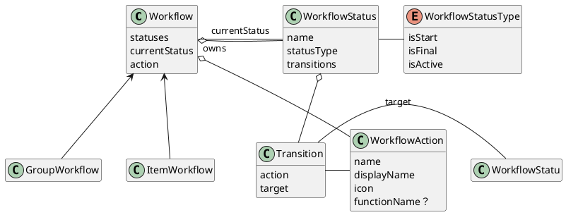
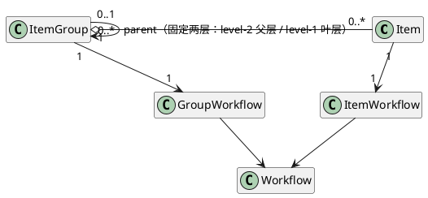

# Diagram

## workflow




## ItemGroup



# description

## workflow

workflow is the parent of item workflow and item group workflow

workflow owns 1 to more status
workflow owns 1 to more actions
status owns 1 to more transitions
transtion belongs to 1 status
transtion has one action, once action is triggered, workflow will transition to target status. action must be one of actions of workflow, so, when workflow is in a give status, all allowed actions are actions of its transition

each status must be in a give WorkflowStatusType. 
workflow must have at least isStart type status, and at least isFinal type status

now, we may not be able to create user customized workflow action, so we should define some functions, and map workflow actions to thse functions, like Complete, Start, Switch, Forward, Backward, Cancel.
so, we have a list of predefined actions. action in transition must choose from the list, and target stasut must choose from status list of the workflow

## item group

assume we have 2 level of item groups, level 1 is the level which is nearest items, it means it contains items.level2 is the parent of level1, and so on. for example: sprint is level1, epic is level2.

3 cases:
### 2 levels

we have 2 levels item groups, like Epic -> Sprint, or 期 -> 主题, 
for example for we a demo data:
level2 item groups:
```
Epic 26-2
Epic 26-3
Epic 26-4
```

now, epic 26-3 is an active epic, means it's neither isStart now isFinal, but isActive. and Epic 26-2 is Done, Epic 26-4 is Todo

I'd like to show Epic 26-2, 26-3 and 26-4 in Side directly

> 落地（2026-11，YPJ-111/112，spec 0111/0112）：已实现。level 实际方向：level-1=叶层（挂 item，sprint）、level-2=父层（哑容器：不挂 item、不开放手动动作、状态由子组联动推导）；建类型自底向上分配 level。两层项目不变量：新建叶层组必挂父；侧栏两级树（active 展开/其余折叠）；「当前 epic」三入口单源（syncCurrentParent）。跨 epic 移动 sprint（组改父）未做——YPJ-160。


### 1 levels

just like current situation: we have sprint level only. the difference is: currently sprint is hardcoded, and we have SprintService and SprintController, which I said we should remove before.
Now, all business logical will be at ItemGroupService/ItemGroupController, but 'Sprint' is the name of ItemGroup, 'Start Sprint' and 'Complete Sprint' are name of action, they're configured, not hardcoded.

in sidebar, Epic block will be removed. 

> 落地（2026-11，spec 0100 切片B）：SprintService/SprintController 已删，全归 ItemGroupService；平面模式（无 level-2 类型）侧栏即平面列表，Epic 块不存在。

### no itemGroup

item group的目的是要管理过多的items。在一个没有item group的系统里，所有的items堆到看板里，导致很难快速定位到我们需要的items，我们使用linear管理项目的后期就发生的这种情况，我需要仔细的找才能找到我需要的item。有了backlog可以缓解还重来没有in progress的items的问题，但对于进行中和done的项目，没法避免堆砌在看板上。我曾经的想法是使用搜索，hide done item的方法来提高关心的item的可见性。而现在这又是我们当前这个no item group所面对的问题。系统是否能no itemgrou？如果能no itemgrou，如何管理？