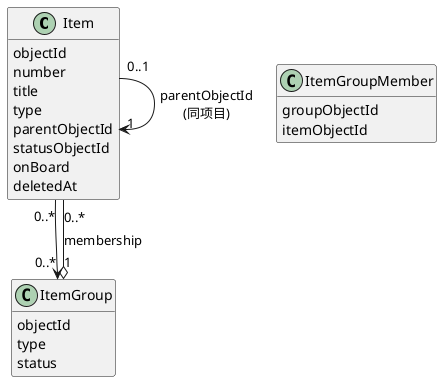

# Parent-Sub-item(父/子 item)设计

> 2026-11-05 起草。前半(现状/模型)按 repo 代码与 ADR-0002 整理;后半为目标设计,含待拍板项。
> 关联:ADR-0002(Item 同质树)、ADR-0008(group type levels)、docs/designs/ItemGroup.md(item group 层级)。

# Diagram

## 现状模型

要点:**父子树**与**组归属**是两条正交的边。parentObjectId 是组织结构(一条边,单亲);membership 是交付/规划归属(sprint/release 等,多对多)。

# Description

## 现状(as-built,ADR-0002)

- `Item.parentObjectId: UUID?` 自引用,单亲,同项目内(parent 与 child 必属同一项目——建挂时校验)。
- **同质树**:父子都是 Item,无独立实体;没有独立的 "Sub-item" 类型——child 就是普通 item。
- 环守卫:改挂父时沿新父链上行,遇自身拒绝(hops 上限 10000 兜底)。
- 软删/恢复:`ItemTreeRepository.updateSubtreeDeletedAt` CTE 递归整棵子树同删/同恢复;硬删(purge)同理。
- 排序:兄弟按 number(项目内递增),无独立 sibling order 字段。
- 读:无专门 children 端点;`GET /items/{id}` 带 parentNumber;列表平铺。

## 目标设计(建议稿)

### 1. 语义定位:两案(伞 item / 非伞父 item),联动方向单向(子 → 父)

父-子之间有状态联动,方向恒为**子驱动父**,父永不自动改子。分两案:

#### 案A:父 item 是伞 item(umbrella;无自身需求,无 github 分支)

父不承载交付,只是容器;其生命周期完全由子件推导:

- 所有子件中**第一个**进入 In Progress(active)→ 父自动进入 In Progress;
- **最后一个**子件进入 Done → 父自动进入 Done;
- 存在非 Done 子件时,**父不能进 Done**(拦截,409/校验层);
- 若确要提前完成父件:把非 Done 子件从父下**摘除**(parent 置 null 或改挂),父即满足完成条件——摘除是显式动作,留痕(item activity)。

#### 案B:父 item 是真实交付 item(有自身需求、有 github 分支)

父自身参与工作流,子件是分解出的执行件。**联动规则与伞案完全一致(2026-11-05 拍板)**:

- 首子进 In Progress → 父若仍处 start 态,自动进 In Progress;
- 末子 Done → 父自动 Done;存在非 Done 子件 → 父不能进 Done;提前完成 → 摘除非 Done 子件。

> 拍板理由(2026-11-05):父 item **没有 github 分支时无法判定它是否伞 item**——无分支的父一律按伞案自动驱动;只有「建了分支、进过 In Progress、又退回 Todo」的父才存在案B 语义,此时仍应自动进入 In Progress(与伞案对齐)。两案规则统一为同一套自动联动。

### 2. 深度:任意多层(2026-11-05 拍板,待拍板②已裁)

模型不限(API 无一层校验);backlog/board 的分组单位取**顶层祖先**(top-level ancestor,沿 parent 上行到根),衍生口径写入 backlog/board 谓词。

### 3. 子件与 sprint(group)归属:不强制一致

子件可独立挂 sprint(它是 item,完整享有组归属语义);parent 挂不挂 sprint 与子件无关。派生规则只用于展示:
- 自动挂载(YPJ-120,开始动作入 active level-1 组)只作用于**被操作的 item 本身**,不沿树传播;
- 看板/backlog 不按树折叠(v1):子件是独立卡片。若后续嫌看板噪音,再叠「按 parent 分组」展示开关(纯前端)。

### 4. 移动语义:换父 = 子树整体跟随;摘除 = 单件操作

- 改 `parentObjectId` 时子树自然跟随(树结构属性,无需额外操作);环守卫已有。`parent = null` 即提升为顶层 item,子树不变。
- **摘除**(联动规则用到的动作)= 只把该子件的 `parentObjectId` 置空,其自身子树不变;与「改挂到别的父」共用同一端点。
- 摘除/改挂写 item activity 留痕(伞案提前完成依赖此审计)。

改 `parentObjectId` 时子树自然跟随(树结构属性,无需额外操作);环守卫已有。`parent = null` 即提升为顶层 item,子树不变。

> 待拍板③:是否需要「移动父件时把子件拆出去/连同移动」两种模式的显式选择?建议 v1 只有「子树整体跟随」一种,不做选项。

### 5. 端点增量(最小)

- `GET /items/{id}/children`:直接子件列表(按 number 排序);
- `GET /items/{id}/tree`:子树(深度受 §2 约束,一层则即 children + 各自 children 为空);
- 建子件:复用 `POST /items` 带 `parentItemId`(已支持);改挂:复用 `PATCH /items/{id}` `parentItemId`(已支持)。
- `api.http` 同步补 children/tree 区块。

### 6. 删除/恢复:现状保持

子树同删同恢复(CTE 已实现);**父删子不删**的孤儿场景不存在(软删以子树为单位)。purge 同理按子树。

### 7. 展示(item 详情/列表)

- 详情页:children 区块(标题/状态/进度),可跳转;
- 列表/backlog:顶层平铺不变;child 在详情页内呈现,不进平铺列表——**避免 Linear 后期「找 item」的堆砌问题**(见 ItemGroup.md §no itemGroup 的动机)。
- 进度 rollup:派生计算(子件 final 数 / 总数),不落库。

## 待拍板汇总

| # | 问题 | 拍板/建议 |
|---|------|------|
| ① | 案B 父件是否随首子自动开始? | **拍板:自动**(2026-11-05;无分支父不可判伞,统一自动联动) |
| ② | 深度:限一层 or 任意? | **拍板:任意多层**(分组取顶层祖先) |
| ③ | 移动父件:拆分选项? | **拍板:子树整体跟随,不做选项** |
| ④ | 「最后一个子件 Done → 父 Done」的"最后"判定:按 final 状态集合还是 statusType==FINAL? | 建议 statusType==FINAL(workflow 语义,不点名 Done) |
| ⑤ | 自动迁移失败时(父无对应出边/终态)如何处理? | 建议静默跳过 + 日志(同 YPJ-120 自动挂载先例),不阻塞子件迁移 |

## 非目标

- 父 → 子方向的任何自动状态变更(联动只单向:子 → 父);
- 跨项目父子;
- 独立 Sub-item 实体或类型(保持同质树);
- sibling 手动排序(number 排序已够 v1)。

父-子 任务之间的状态联动：

- 父item作为伞item，无github分支，
  - 所有子项目中第一个进入In progress，伞item进入in progress。
  - 最后一个子item进入Done，伞item进入Done
  - 如有item不是Done，伞item不能进Done
  - 若认为伞item 已done，可将所有非Done子item从伞下去掉
- 父item作为有真实需求的item，有github分支
  - 父item