[TOC]

# 扬州 yangzhou 用户手册

> 面向 QA 的全功能操作手册。基于 v2026.11 版本(build 2026.11.07.9),截图取自演示项目「QA / 演示项目」。
> 阅读约定:**粗体** = 界面上的按钮/字段原文;`KEY-N` = item 编号;「面板」= 弹出对话框;「侧栏」= 项目左侧导航树。


## 1. 系统是什么

扬州(yangzhou)是开源项目管理系统,核心是**匹配引擎**:每个 Item 可以声明**需求**(词表属性 × 最低等级),系统把需求与成员的**能力**(自评等级 1–4)做匹配,输出单人可行性判定与候选建议。

两个核心概念,先记牢:

| 概念 | 一句话 |
|---|---|
| **Item** | 工作单元(不是"任务"这个口语,是唯一的工作实体);有编号、状态、负责人、需求;可挂子条目形成层级 |
| **ItemGroup** | Item 的命名集合(组),两级树:父层组(聚合,如 Epic)、叶层组(执行);**时间盒类型即 Sprint** |

状态区分两层,不要混淆:

- **Item 状态机**(项目级):To Do → In Progress → In Review → QA → Done,由「工作流」面板配置;
- **分组类型 workflow**(类型级):组(如 Sprint)自己的状态机(planned → active → completed),决定「开始 Sprint / 完成 Sprint」这类动作按钮,由「分组类型管理」面板查看与编辑(见 §9)。

---

## 2. 快速开始

### 2.1 登录与首次初始化

打开站点即见登录页。**全新服务器会以首个登录账号自动完成初始化**——第一个注册的账号自动成为 workspace 管理者。


输入**用户名**与**密码**,点**登录**。登录后落在主页(或上次访问的项目页)。

### 2.2 创建项目

主页「项目」区:填 **KEY**(2–10 位大写字母/数字,如 `CHE`、`QA`,创建后不可改)与**名称**,点**创建项目**。


- 项目卡片右侧的 ☆ 可**收藏**,收藏后顶栏出现快捷星标;
- 下方支持**搜索项目**、**按 KEY/名称/时间排序**、勾选**显示已归档**;
- 点卡片任意处进入项目空间。

> 创建项目时系统自动种子:item 状态机(To Do/In Progress/In Review/QA/Done)、Release 类型。**Sprint 类型不自动建**——需在「分组类型管理」里新建一个勾选**时间盒**的类型(见 §9),之后侧栏才出现 Sprint 段。

---

## 3. 全局工作台

顶栏固定七个入口(任何页面都在):

| 入口 | 内容 |
|---|---|
| **主页** | 驾驶舱(见下) |
| **我的能力** | 自己的能力自评(见 §7.3) |
| **词表** | workspace 级属性字典(见 §7.1) |
| **成员** | 成员管理 + 各成员能力(见 §13.2) |
| **站会** | 每日站会三栏视图(见下) |
| **回收站** | 已删除 item,可恢复 |
| **收藏 ☆** | 收藏的项目快捷跳转 |

其余顶栏控件:

- **编号跳转**:输入 `KEY-N`(如 `YPJ-59`)回车,直达对应 item 详情;
- **🔔 通知**:被指派、被阻塞等事件的通知中心,数字角标为未读数;
- **退出登录**:清除本地凭证回登录页。

### 3.1 主页(驾驶舱)


- **今日名下**:今天该你处理的 item(在 sprint 中、你负责的);
- **阻塞中**:被依赖卡住的 item;
- **昨日完成**:昨天状态进入终态的 item;
- **进行中**:所有进行中 sprint 的卡片条(名称 + 日期);
- **项目**:项目列表 + 创建表单;
- **短板面板**:跨项目聚合的能力缺口提示(暂无缺口时显示「暂无缺口 ✓」)。

### 3.2 站会


选择成员(下拉),展示其**昨日完成 / 今日名下 / 阻塞中**三栏及其计数,用于每日站会口头同步。

### 3.3 回收站


item 删除后进入回收站,可在此恢复或彻底清空;空态显示「回收站是空的」。

---

## 4. 项目空间与侧栏

进入项目后默认落在**看板**页。布局分两部分:

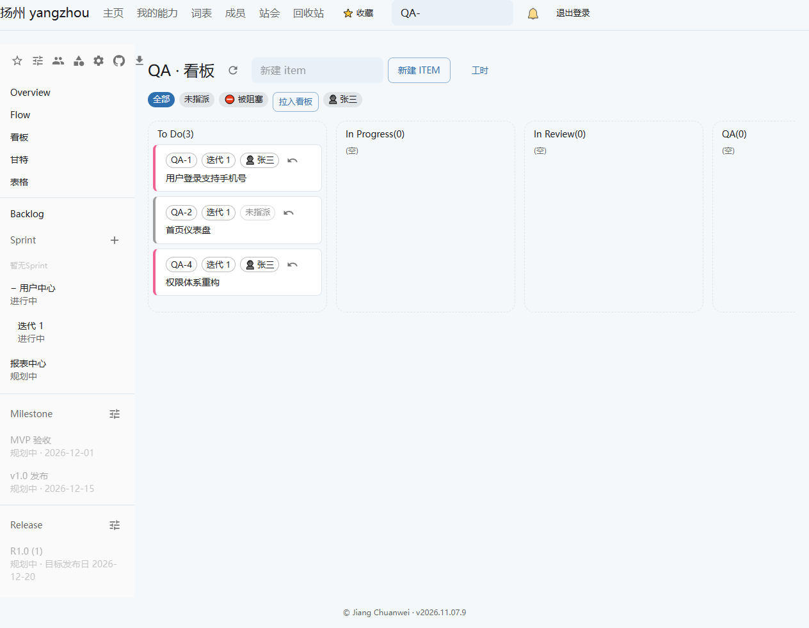

**左侧栏**(从上到下):

1. 项目名 + 收藏星 + **图标行(6 个图标按钮)**:
   - ⚙ 工作流(§12)
   - 👥 成员池(§13.2)
   - ▦ 分组类型管理(§9)
   - ⚙ 项目设置(§13.1)
   - GitHub 配置(§13.4)
   - ⬇ 导出 Excel
2. 页面导航:**Overview / Flow / 看板 / 甘特 / 表格**;
3. **Backlog**(未进任何时间盒组的非终态 item);
4. **Sprint 段**:每个时间盒类型一段,段头「+ 新建 Sprint」;段内按「父层组 → 叶层组」两级展示,组名下小字是组状态(进行中/规划中),点击进 sprint 详情(§8.2);
5. **Milestone 段** + 管理(§11);
6. **Release 段** + 管理 Release(§11)。

> Milestone/Release 段可通过项目设置关闭显隐(数据不删)。

---

## 5. 看板

看板是项目日常主战场:**列 = item 状态**,卡片在列间拖动即改状态。


**页头**:

- **刷新** ↻:重拉数据;
- **新建 item** 输入框:填标题直接回车/点**新建 ITEM** 快速建卡;
- **工时**:跳转工时页(§10.5)。

**筛选行**:**全部 / 未指派 / 被阻塞** 三个快切;**拉入看板** 只显示在 backlog 且可拉入的;**负责人** 过滤;再次点击取消。

**卡片**信息:

- `QA-N` 编号(点击进详情);
- Sprint 徽标(所属时间盒组);
- 👤 负责人 或「未指派」;
- 标题;第二行显示需求摘要(如「前端开发≥2」);
- 左侧**红色竖边** = 有未完成依赖(被阻塞);被阻塞卡片带红色「被阻塞」chip;
- 卡片右侧 **↩** = 退回 Backlog(移出 sprint 成员行并退回 backlog 列)。

**列底空态**显示「(空)」。**拖拽卡片到其他列**即改状态(状态机不允许可行的迁移会被拒绝)。

---

## 6. Item 全生命周期

### 6.1 新建

三处入口:

1. 看板页头**新建 item** 输入框 + **新建 ITEM** 按钮(标题即建,其余默认);
2. Backlog 页同样的输入框/按钮;
3. Sprint 详情页**拉入 ITEM**(建卡直入该 sprint,§8.2)。

Backlog 页面(未进 sprint 的 item 池,带「拉入看板」): 

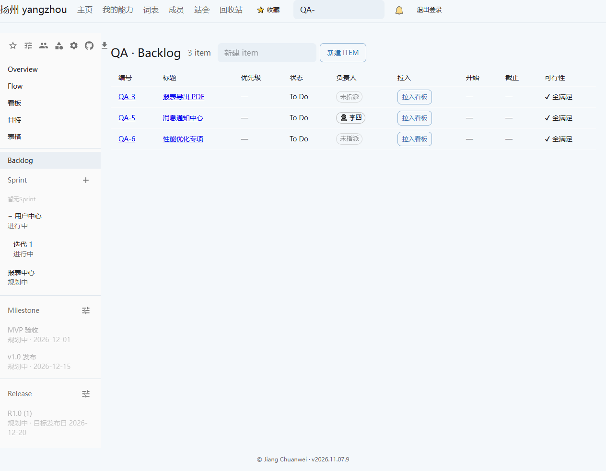

### 6.2 详情页

点任何 `QA-N` 编号或卡片标题进入详情:

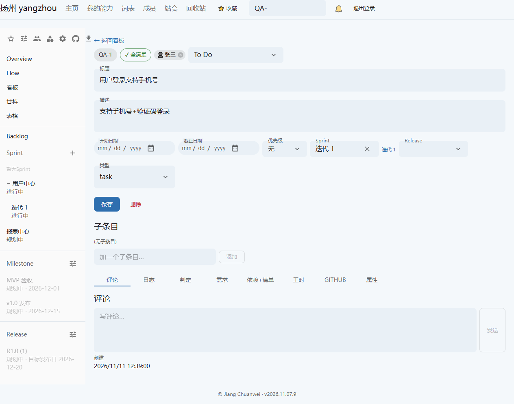

**头区**:`QA-1` 编号、**✔ 全满足/有差距/有缺门** 可行性徽标、👤 负责人(点 × 清除)、状态下拉(直接改状态)。

**表单区**:

| 字段 | 说明 |
|---|---|
| **标题** | 必填 |
| **描述** | 自由文本 |
| **开始日期 / 截止日期** | 填写后出现在甘特图(§10.3) |
| **优先级** | 下拉(默认「无」) |
| **Sprint** | 已挂时间盒组时显示,× 移除(退回 backlog) |
| **Release** | 挂到发布(§11.2) |
| **类型** | `task` 等下拉(项目可扩展) |
| **保存** | 提交全部修改;**删除**:进回收站 |

**子条目区**:输入标题点**添加**建子 item;子条目形成同质树(不能把自己祖先挂成子级),子树即"无限分级"。

**信息 Tabs**(8 个):

| Tab | 内容 |
|---|---|
| **评论** | 团队讨论;输入框 + **发送**;下方显示创建时间 |
| **日志** | 状态变更/指派/编辑历史时间线 |
| **判定** | 匹配引擎输出(§7.4) |
| **需求** | 需求声明与编辑(§7.2) |
| **依赖+清单** | 依赖(阻塞/被阻塞)与验收清单勾选项 |
| **工时** | 计时/补录工时;记录后看板「工时」页有汇总 |
| **GITHUB** | 关联分支/PR(需 workspace 配置 GitHub PAT,§13.4) |
| **属性** | 自定义属性(custom 类词表条目)键值 |

### 6.3 状态流转

- **拖拽**(看板)或**状态下拉**(详情页)改状态;
- 迁移受项目工作流约束(§12):自由迁移模式下任意列可互迁;配置迁移表后只能按声明的 from→to 走;
- 进终态(Done)后从 backlog/sprint 的活跃统计里移除。

---

## 7. 匹配引擎:需求与判定

这是本系统的差异化能力,QA 重点回归对象。

### 7.1 词表(workspace 级属性字典)

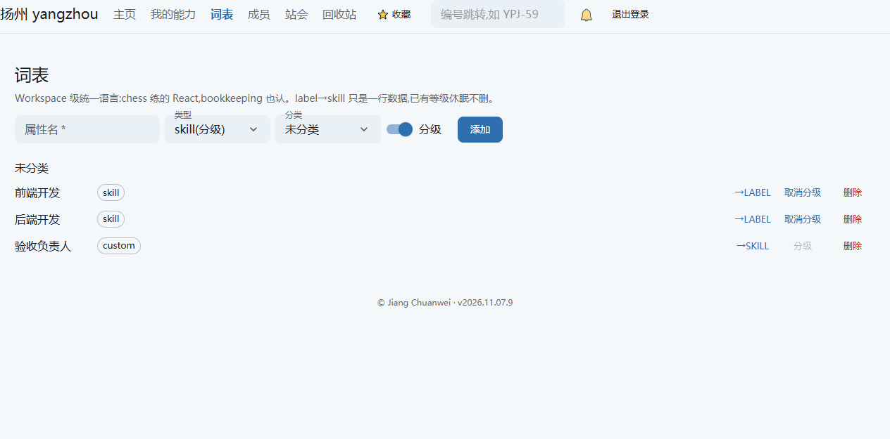

顶栏**词表**进入。所有匹配用的「属性名」都出自这里,workspace 全局共享。

- **新建**:填**属性名**,选**类型**:
  - `skill(分级)`——技能,可分级,进匹配引擎;
  - `label`——标签,只做标记不分级不匹配;
  - `分类`(category)——作为其他属性的分组节点;
  - `自定义`(custom)——item 自定义属性(如「验收负责人」),不参与匹配;
  - **分级开关**:开 = 参与等级匹配;**分类**下拉 = 挂到某个 category 节点下;
  - 点**添加**。
- **列表**:按分类分组展示;每行操作:**→LABEL / →SKILL**(切换类型)、**取消分级 / 分级**、**删除**(被能力/需求/item 属性引用时拒绝)。

### 7.2 Item 需求(匹配的输入)

Item 详情 → **需求** tab:

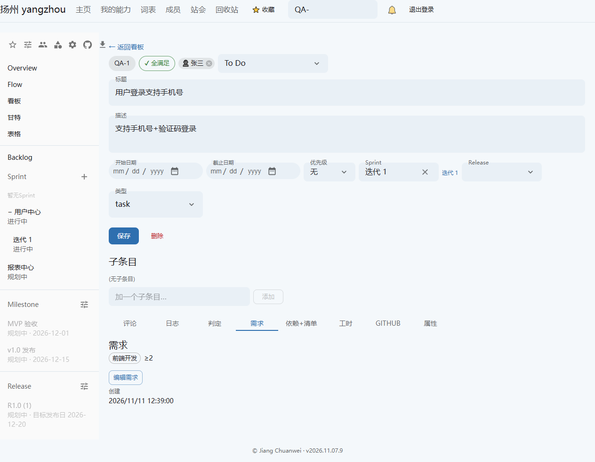

- 已有需求显示为 chip:属性名 + `≥N`(如「前端开发 ≥2」);
- 点**编辑需求**进入编辑态:添加若干行(词表属性 + 最低等级 1–4),整体保存(替换式);
- 需求只声明「需要什么」,不指名道姓——由引擎算谁合适。

### 7.3 成员能力(匹配的另一输入)

顶栏**我的能力**:为词表中每个 skill 类属性自评 **Lv1–Lv4**;「无」= 没有该能力(参与匹配时算缺门)。改动立即生效,所有项目可行性随之更新。

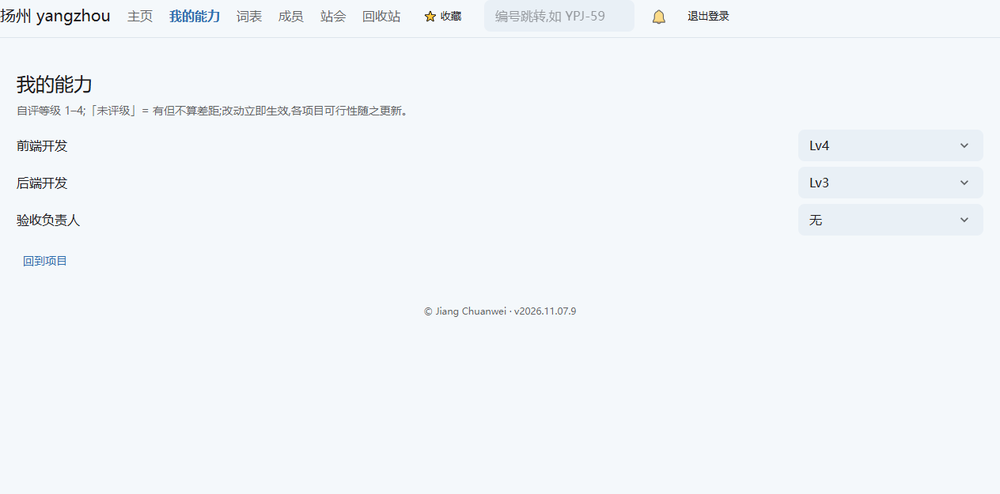

成员间能力互评/维护在**成员**页(§13.2)。

### 7.4 判定(匹配的输出)

Item 详情 → **判定** tab:

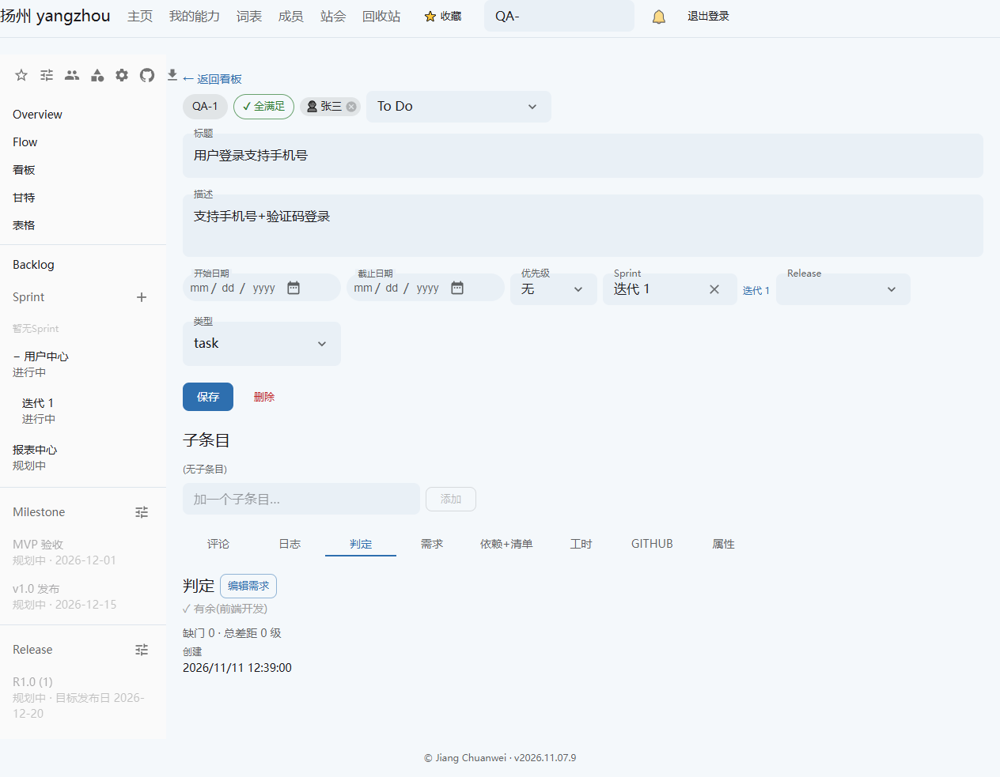

- **逐条**:每条需求给出当前负责人的满足情况——`✓ 有余(前端开发)`(等级高于要求)/ 有差距(低 1 级内)/ 缺门(没有);
- **汇总**:`缺口 0 · 总差距 0 级`——缺门条数与等级差距总和;
- 头部徽标三色:**✔ 全满足**(绿)/ **△ 有差距**(黄)/ **✗ 有缺门**(红)。

**候选建议**:配置了成员池后,item 详情(或 API)可拉取候选列表——仅池内成员,按绿/黄/红排序,每条附可解释的差距明细;可直接从候选指派。

> 匹配规则速记:角色类属性不进匹配输入(ADR-0003);等级刻度 1–4;min-level 只卡关键路径。

---

## 8. Sprint 与分组

### 8.1 时间盒类型 = Sprint 语义

「Sprint」在本系统不是写死的名字,而是一种**勾选了「时间盒」的分组类型**(见 §9)。勾选后该类型:

- 获得 Sprint 同款 workflow 模板(planned → active → completed,开始/完成/后退/重开);
- 自动占据 **level-1**(全项目恰一个),成为 backlog/看板/甘特/月历/velocity 的**数据源**;
- 侧栏出现「+ 新建 Sprint」段头。

例如建一个叫 `Iteration` 的类型勾上时间盒,它就是你们的 sprint——语义挂在开关上,不挂在名字上。

### 8.2 Sprint 组详情

侧栏 Sprint 段点组名(如「迭代 1」)进详情:

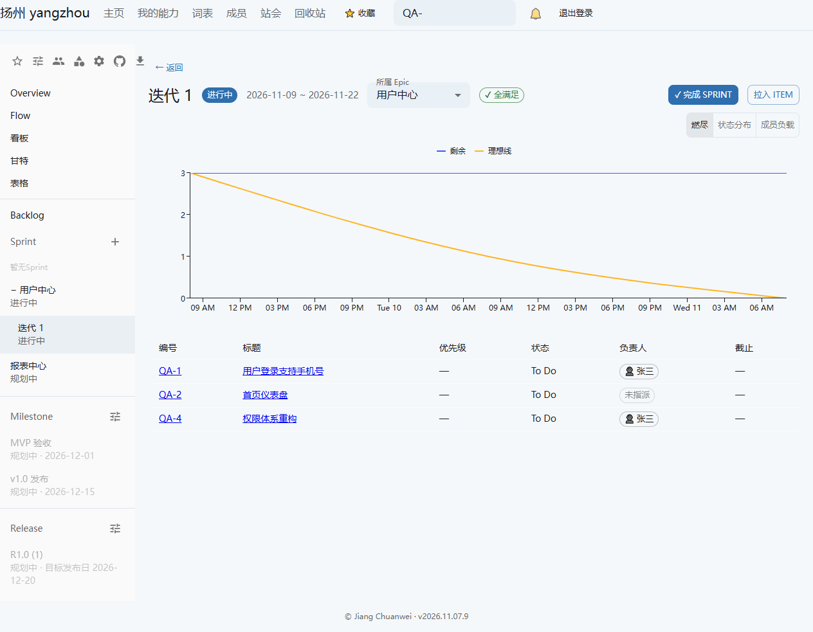

**头区**:

- 组名 + 状态 chip(进行中)+ 起止日期;
- **所属 Epic** 选择器(两级项目才显示):把 sprint 挂到父层组(如「用户中心」);
- **✔ 全满足**:组内 item 可行性聚合;
- **✔ 完成 SPRINT**:执行组动作——按钮由该类型的 workflow 出边渲染(§9),Sprint 模板给出「开始/完成/重开」等;完成后组状态进终态;
- **拉入 ITEM**:新建 item 直入本 sprint;
- 视图切换:**燃尽 / 状态分布 / 成员负载** 三个 tab,默认燃尽(剩余 vs 理想线)。

**item 表格**:组内全部 item(编号/标题/优先级/状态/负责人/截止),点击进详情。

### 8.3 组的两级树与改挂

- 两级项目的叶层组(如 sprint)创建时必须挂父层组(如 Epic),改挂通过 Sprint 详情「所属 Epic」或 API;
- 父层组状态由子组自动聚合:任一子 active → 父 active;全子终态 → 父终态;无子不动;
- 空的类型才可删;组下仍有 item 时删除被拒绝(409)。

---

## 9. 分组类型管理(workflow 可编辑)

项目页图标行 **▦(分组类型管理)** 打开面板——**单层弹出,信息全显,就地编辑**:

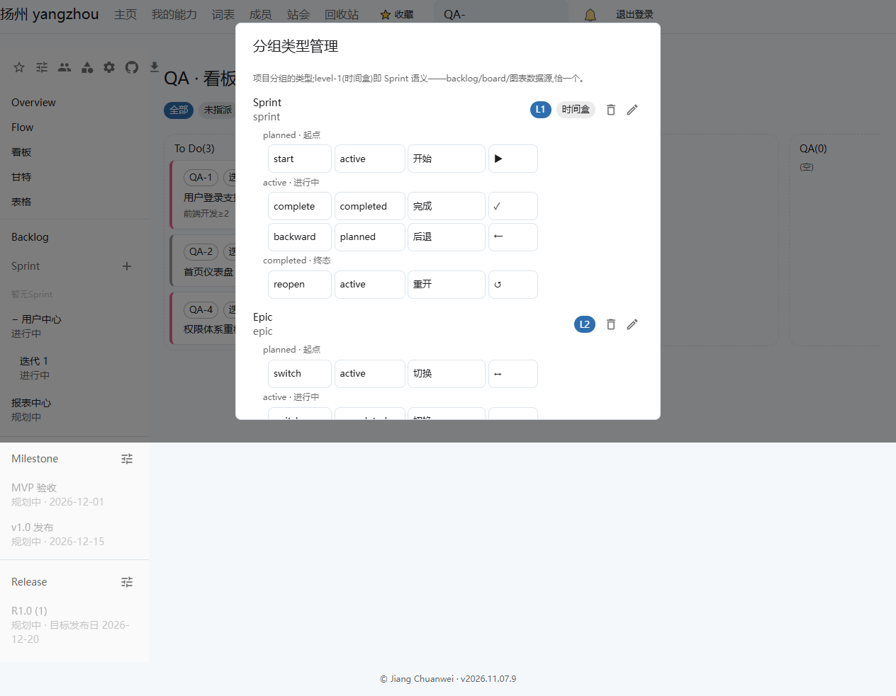

**面板结构**:

- 每个类型一块:**名称 / typeKey / 层级 chip(L1、L2)/ 时间盒 chip** + 操作(**🗑 删除**[仅非内建、空类型]、**✏ 编辑**);
- release 类型是系统内建专属域,**不出现在本面板**;
- **workflow 区(打开即见,无需点击)**:每状态一行小字(`planned · 起点`),状态下的**出边行 = 4 槽展示行**:

```text
[ start ] [ active ] [ 开始 ] [ ▶ ]
  fn       target     label   icon
```

四槽与编辑态同构,纯展示不可编辑。

- **点 ✏ 进入编辑模式**(同一面板内,行骨架不变):四槽变控件——fn 下拉(英文函数名)/ target 状态下拉 / label 文本(按字典预填可改)/ icon 预定义下拉((无) + 7 符号)+ 删边;每状态有**加出边**;类型级**保存 / 取消**;
- label/icon 缺省值来自内置数据字典(fn 中文名与预定义 icon 唯一来源),换函数自动重预填;
- **保存**后回展示态,改动立即反映;校验失败(409/400)显示错误条且草稿保留;
- 未保存草稿在**关闭面板时丢弃**;
- 关闭面板会刷新侧栏(新建了时间盒类型 → Sprint 段立即出现)。

**新建类型**(面板底部):**typeKey**(小写字母开头,2–20 位)+ **名称** + **时间盒**勾选 → **新增**。类型按创建顺序自动分配层级(第一个建的是 L1);想换层级需先删后建(须为空)。

> 改类型名、删组、组改挂等低频操作走 REST API(`backend/script/api.http`),UI 未覆盖。

---

## 10. 数据视图:Overview / Flow / 甘特 / 表格 / 工时

### 10.1 Overview

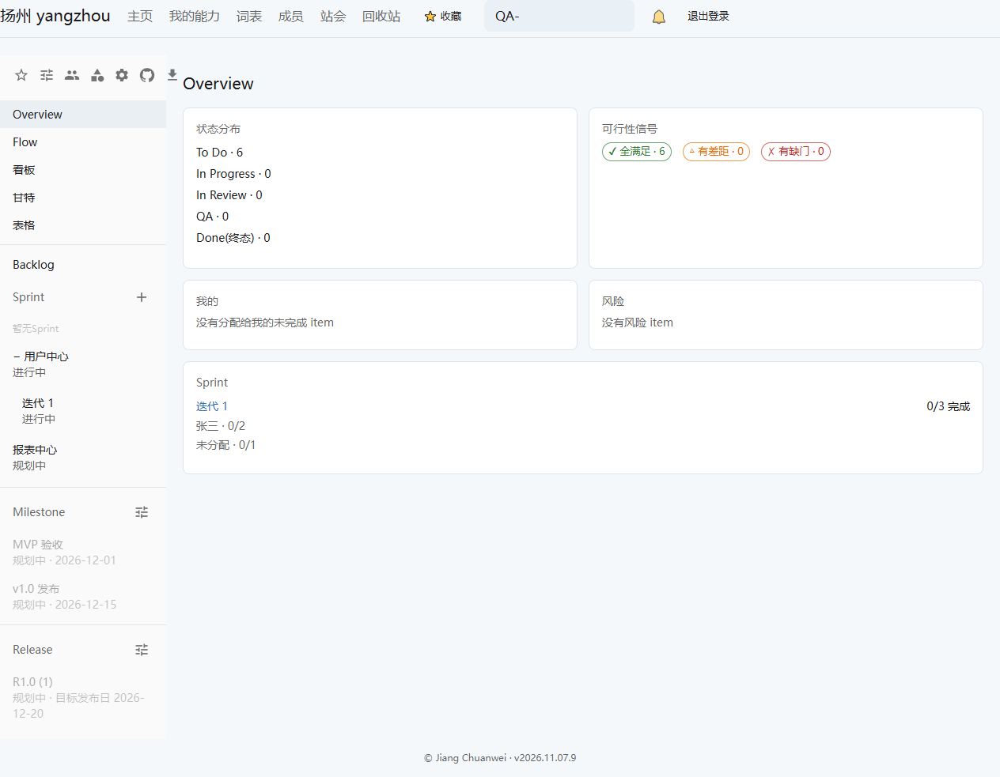

- **状态分布**:各状态 item 计数;
- **可行性信号**:✔ 全满足 / △ 有差距 / ✗ 有缺门 三色计数;
- **我的**:分配给我的未完成 item;
- **风险**:被阻塞/超期 item;
- **Sprint**:每个 sprint 的完成度(按人拆分:`张三 · 0/2`)。

### 10.2 Flow(流量度量)

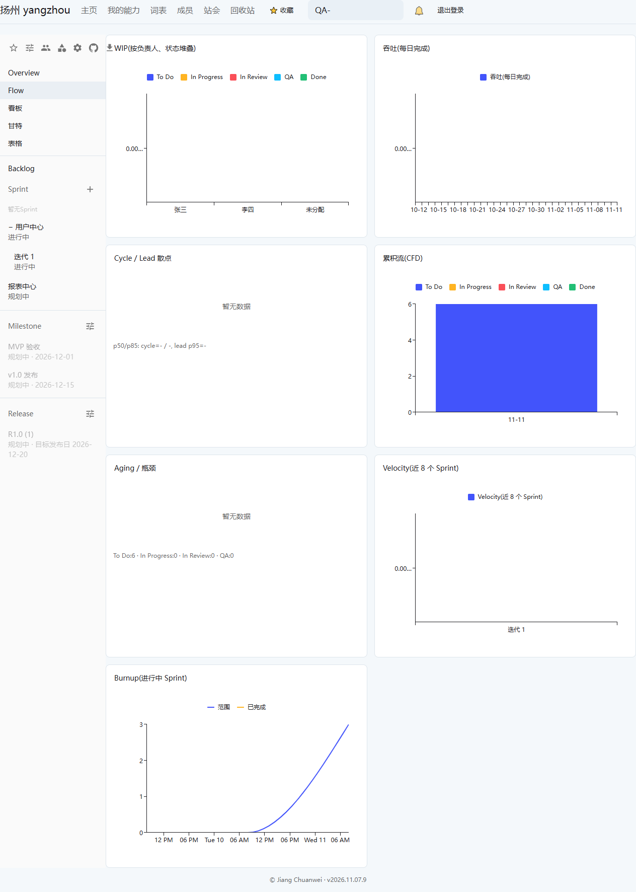

七张图:**WIP**(按负责人×状态堆叠)、**吞吐**(每日完成数)、**Cycle/Lead 散点**(p50/p85 周转/交付时长)、**累积流 CFD**(各状态面积)、**Aging/瓶颈**(在制时长)、**Velocity**(近 8 个 sprint)、**Burnup**(进行中 sprint 范围 vs 已完成)。数据少时显示「暂无数据」。

### 10.3 甘特

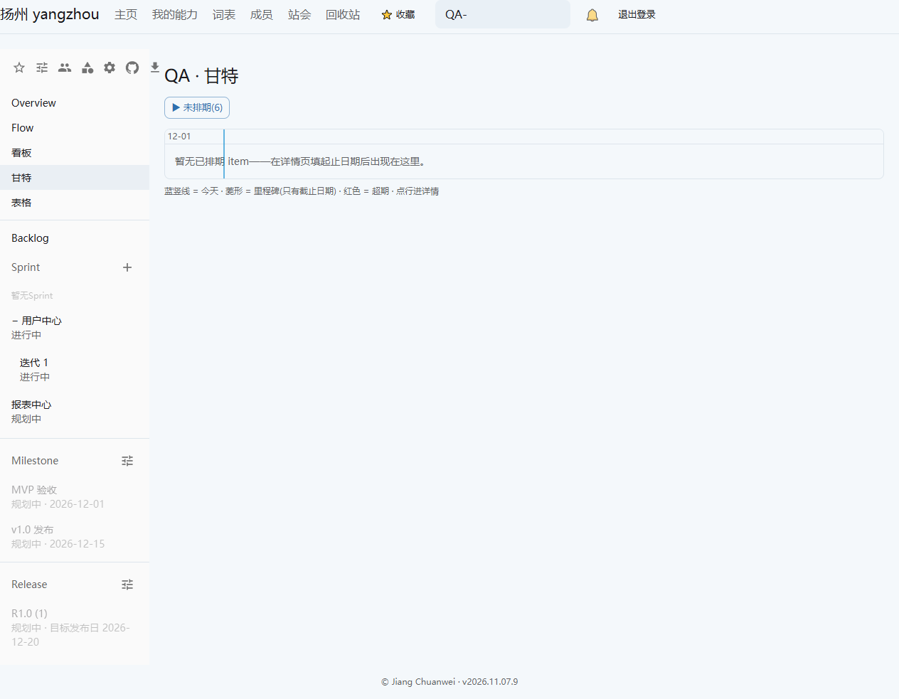

- **未排期(6)** 开关:切换显示无起止日期的 item;
- 时间轴:蓝竖线 = 今天,菱形 = 里程碑,红色条 = 超期;点条进详情;
- 在 item 详情填**开始/截止日期**后条目即出现在这里。

### 10.4 表格

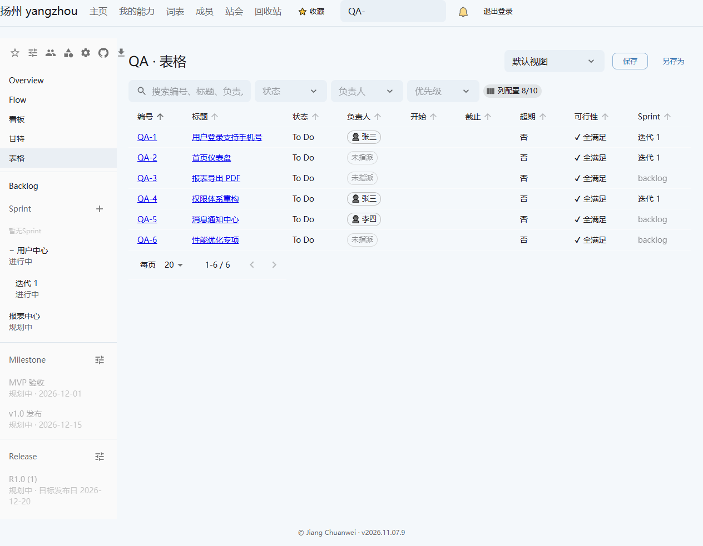

- **视图系统**:右上视图下拉 + **保存 / 另存为**——视图记住筛选、列配置、排序;`views` 按 token 用户隔离(401 旧 token 会导致视图加载失败,重登即愈);
- **搜索**:编号/标题/负责人模糊匹配;
- **筛选**:状态 / 负责人 / 优先级 三下拉;
- **列配置 8/10**:弹层调列显隐与顺序(标题列锁定);
- 默认列:编号 / 标题 / 状态 / 负责人 / 开始 / 截止 / 超期(否) / 可行性(✔ 全满足) / Sprint;
- **分页**:每页 20,底部翻页。

### 10.5 工时

看板页头**工时**进入(或 item 详情「工时」tab 计时/补录)。按人/日汇总,无记录时提示「还没有工时记录——在 item 详情里开始计时或补录」。

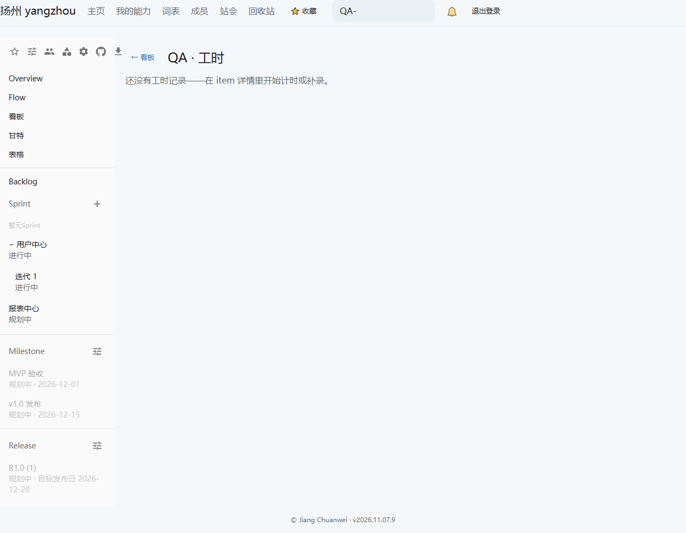

---

## 11. Milestone 与 Release

两个"时间容器",都挂在项目级、侧栏各一段;可用项目设置隐藏。

### 11.1 Milestone(里程碑)

侧栏 Milestone 段头**管理**(▦)打开面板:**新建**(名称 + 目标日期)/ 改名 / 改目标日期 / 删除(终态不可删)。段内列表显示 `MVP 验收 规划中 · 2026-12-01`。item 详情暂无 Milestone 字段,挂接走 API(规划中)。

### 11.2 Release(发布)

侧栏 Release 段头**管理 Release** 打开面板:**新建**(名称 + 目标发布日)/ 编辑 / 删除(组内有成员时拒绝)。item 详情 **Release** 下拉把 item 挂到发布;发布动作完成后 release 进 `released`。侧栏显示 `R1.0 (1) 规划中 · 目标发布日 2026-12-20`(括号内 = 已挂 item 数)。

> Release 是内建专属类型,不出现在分组类型管理面板(移除规划见 backlog)。

---

## 12. Item 级工作流编辑器

图标行 **⚙(工作流)** 打开**工作流编辑**面板——配置的是 **Item 的状态机**(与 §9 的分组类型 workflow 是两回事):

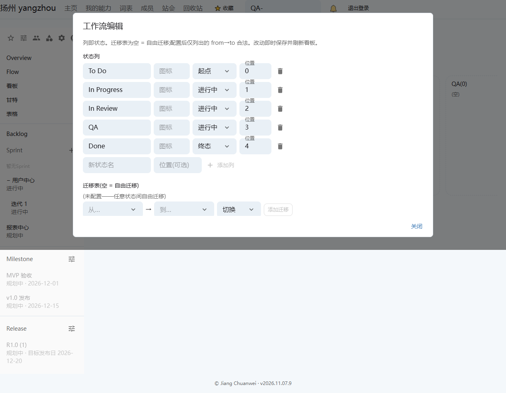

- **状态列**:每行 = 状态名 / 图标(可选)/ 类型(**起点 / 进行中 / 终态** 下拉)/ 位置(排序)/ 删;START 与 FINAL 各恰有一个校验;
- **添加列**:新状态名 + 位置(可选)→ **+ 添加列**;
- **迁移表**:空 = **自由迁移**(任意状态间可拖);添加若干 `from → to` 行后,只有列出的迁移合法;
- 改动即保存并刷新看板列。

---

## 13. 项目设置 / 成员池 / GitHub / 导出

### 13.1 项目设置

图标行 **⚙(项目设置)**:

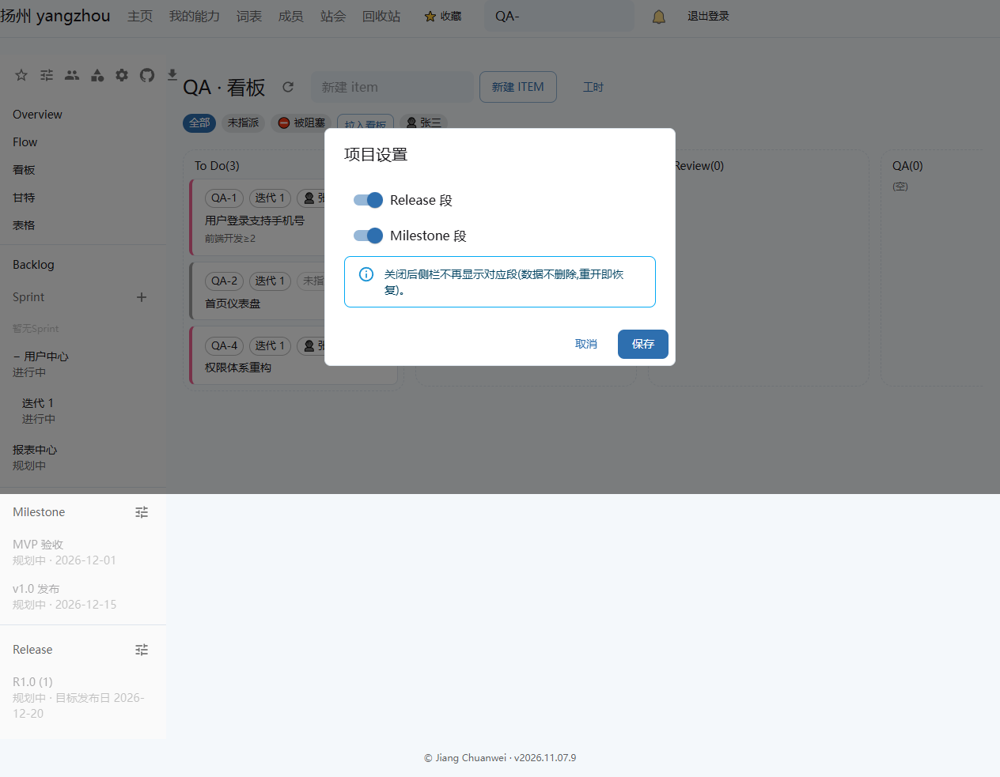

- **Release 段 / Milestone 段**两个开关:关闭后**侧栏不再显示对应段**(数据不删,重开即恢复);
- **取消 / 保存**。

### 13.2 成员池

图标行 **👥(成员池)**:

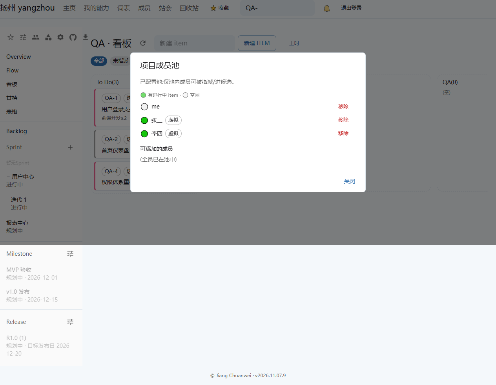

- **已配置池**:池内成员才可被指派/进入候选;每行显示 **●有进行中 item / ○空闲** 状态点 + **移除**;
- **可添加的成员**:从 workspace 成员中选择加入(全员在池时显示「(全员已在池中)」);
- 创建者自动是 **leader**;池管理、设 leader 的完整功能在**成员**页(下)。

### 13.3 成员管理(全局)

顶栏**成员**:

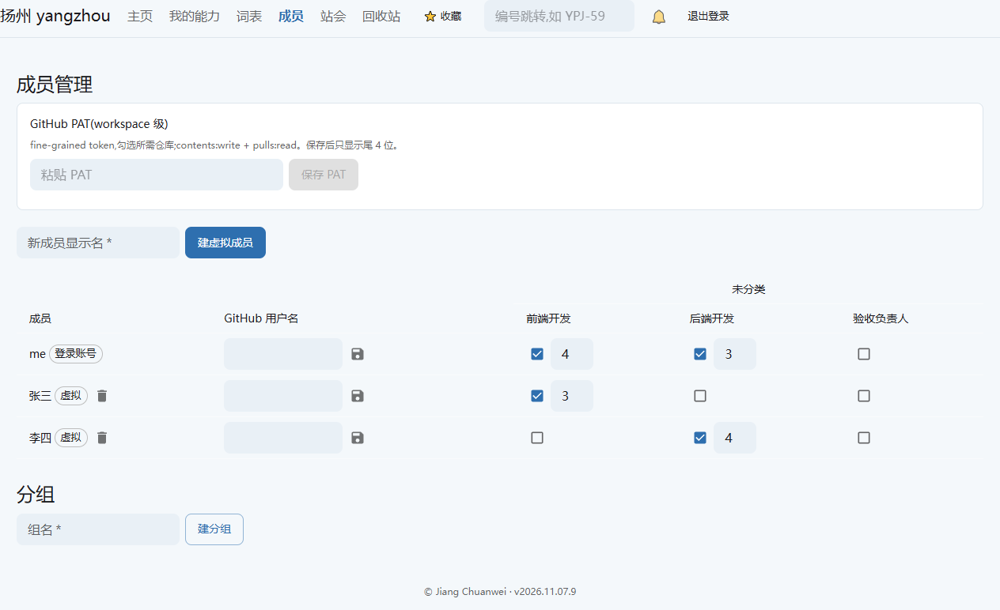

- **GitHub PAT(workspace 级)**:粘贴 fine-grained token(勾选所需仓库 `contents:write + pulls:read`),**保存 PAT**(保存后只显示尾 4 位);
- **创建虚拟成员**:显示名 → 建一个无账号成员(如「张三」「李四」),用于能力建模与指派演练;
- **成员表**:每人一行——**GitHub 用户名**(填写+保存)、各 skill 属性(勾选 = 有该能力 + **等级输入框** 1–4)、**虚拟**徽标、🗑 删除(登录账号不可删);
- **分组**:组名 → **建分组**(成员分组,用于组织结构展示)。

### 13.4 GitHub 集成

配置 PAT 后:项目图标行 GitHub 面板可配 **owner/repo**;item 详情 **GITHUB** tab 关联分支/PR;相关拉取按需触发。

### 13.5 导出 Excel

图标行 **⬇**:导出当前项目 item 全量 xlsx(表格视图同款列),用于线下核对。

---

## 14. 名词表

| 名词 | 定义 | 不要叫 |
|---|---|---|
| **Item** | 工作单元;有编号 KEY-N、状态、负责人、需求;可挂子条目 | Task、卡片 |
| **ItemGroup(组)** | Item 的命名集合;两级树(父层聚合/叶层执行) | 项目、文件夹 |
| **Sprint** | 时间盒类型的组实例;必有起止日期;backlog/board/图表数据源 | 迭代(口语可用) |
| **时间盒(timed)** | 类型级开关:勾选 = Sprint 语义(模板 + level-1 + 日期) | Sprint 类型 |
| **Backlog** | 派生桶:未进任何时间盒组的非终态 item;不是实体 | 待办列表实体 |
| **Status** | Item 的生命周期阶段;列即状态的可视化;START/FINAL/ACTIVE 恰一类 | Column(那只是 UI) |
| **Workflow** | 状态集合 + 合法迁移(内嵌 JSON);Item 级与分组类型级各一套,别混 | 独立实体 |
| **出边(transition)** | 状态间的合法迁移;带 function(动作名)/target(目标状态);组动作按钮由它渲染 | 迁移表(独立表已废) |
| **Attribute(属性)** | 词表条目;kind: skill/label/category/custom;leveled 决定是否分级 | Label、Skill(单独实体) |
| **Capability(能力)** | 成员 × 属性 × 等级(1–4);自评或他人维护 | 技能标签 |
| **Requirement(需求)** | item 声明的「属性 ≥ minLevel」;匹配引擎输入 | 描述文字 |
| **判定(verdict)** | 需求 × 能力 → 绿(全满足)/黄(有差距)/红(有缺门),逐条可解释 | 评分 |
| **成员池** | 项目内可被指派/进候选的成员白名单 | 团队 |
| **leader** | 项目创建者;workflow/类型管理等管理操作有 leader 门控 | 管理员 |
| **阻塞** | item 有未完成依赖;看板红边 + 被阻塞 chip | bug |
| **编号 KEY-N** | 项目 KEY + 项目内自增序号;顶栏可跳转 | ID |

---

## 15. QA 冒烟路径清单

建议每轮回归按此序走一遍(全部 UI 可达,无需 API):

1. **登录** → 主页驾驶舱三栏计数正确;
2. **建项目**(`QA` + 演示名)→ 自动落看板,五列齐全;
3. **建时间盒类型**:图标行 ▦ → typeKey `sprint` + 勾时间盒 → 新增 → 侧栏 Sprint 段出现;
4. **面板零点击可见性**:打开 ▦ 面板,Sprint/Epic 各出边 4 槽展示行直接可见(不点 ✏);点 ✏ 后同槽位变控件;保存/取消/关面板丢弃草稿;
5. **建 sprint**:侧栏「+ 新建 Sprint」→ 名称+日期 → 详情页「开始」→ 状态变进行中;
6. **建 item**:看板「新建 ITEM」→ 详情页编辑标题/描述/日期/类型 → **需求 tab** 加「前端开发 ≥2」→ **判定 tab** 出三色判定;
7. **指派**:成员页建虚拟成员并配能力 → 项目成员池加入 → item 负责人下拉指派 → 判定刷新;
8. **流转**:看板拖卡 To Do → In Progress → … → Done;红边阻塞卡用依赖+清单构造;
9. **四视图**:Overview 计数 / Flow 图表 / 甘特(填日期后出现条)/ 表格(筛选+视图保存);
10. **Sprint 收口**:Sprint 详情「完成 SPRINT」→ 组终态、侧栏灰显;
11. **回收站**:删一个 item → 回收站出现 → 恢复;
12. **设置**:项目设置关 Milestone 段 → 侧栏消失 → 重开恢复;
13. **退出登录 → 重登**:token 失效后视图/数据仍可加载(无 404/500)。

### 已知边界(QA 不当 bug 报)

- 新项目**没有 sprint 类型**,需手工建时间盒类型(spec 0100);
- 分组类型**改名/删除组/组改挂**无 UI,走 API;
- Milestone 与 item 的挂接 UI 未做(API 已有);
- 旧 token 过期会让表格页视图加载报「成员不存在」,重登即愈;
- `next start` 代理窗口冷启动首个请求可能慢(4s+),非功能缺陷。

---

*手册对应代码版本:main @ 2026-11-11(#197 合并后)。截图重生成:`.scratch/demo-data.cjs` 造演示数据 + agent-browser 逐页截图。*
