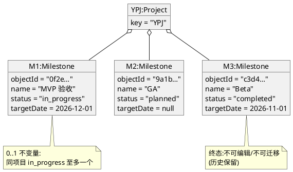
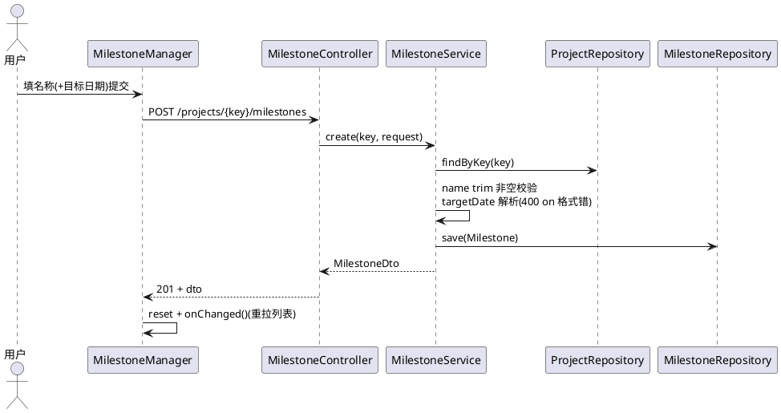
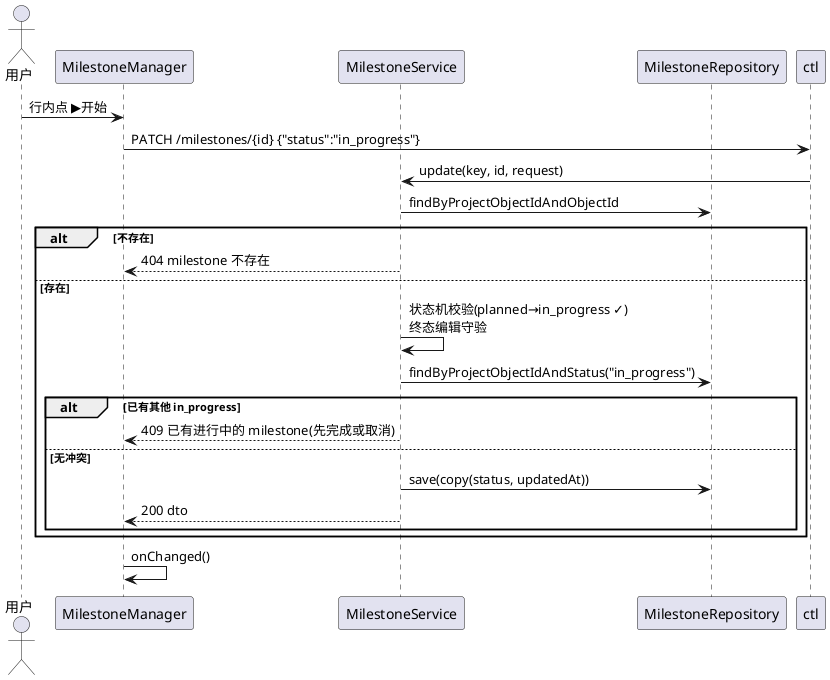
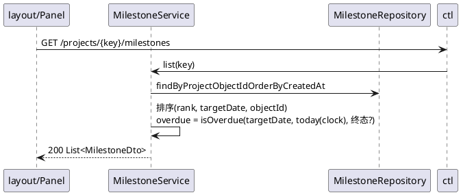

# 0116 — Milestone 域软件需求规格说明书(P0 基线 + P1 三票:定位器/关口/时间线)(YPJ-170 等)

> 上游:`docs/requirement/Milestone-Release PRD.md`(§4.2/§5.2/§5.3/§7)。
> 性质:**软件需求规格说明书(SRS)**——第一部分把 Milestone 域 P0 现状全量文档化(对象图/顺序图/REST API/真值表,as-built);第二部分为本轮 P1 两故事(US-M5/US-M6)的详细设计。评审通过后编码。
> 状态:待评审 · 2026-11-12

---

## 一、需求

### 1.1 范围

1. **P0 基线文档化**(不改码):领域对象、4 个 REST 端点、状态机真值表、核心顺序图、前端形态。
2. **票 1(YPJ-170)= US-M5/US-M6**:双徽标(overdue 红/dueSoon 黄)+ 侧栏收敛 + Milestone 页(`/p/[key]/milestones`,建/改/删/状态)+ description/owner 可空字段(V54)——**交付完整「事件型站 + 定位器」**。
3. **票 2 = US-M7/8/9/10**:gate 挂接(tracks 多归属)+ 关口硬门禁 + 关口就绪度 + Dashboard 北极星卡(V55)——**交付「关口」**。
4. **票 3 = US-M11**:页面时间线区块。
> 三票垂直切片、独立验证绿(2026-11-12 grill 拍板;价值命题 = 定位器 + 验收关口,详见 PRD §7 与 CONTEXT.md 词汇表)。主动通知 = PRD US-M13,另票(§1.2)。

### 1.2 非目标(本轮明确不做)

- completed 重开 / 依赖链 / 基线日期 / 验收条件+证据体系 / 批量挂接与自动圈范围规则;
- **主动通知/提醒**(临期/逾期站内推送):notification 域现状是 **item 中心**(事件驱动、收件人来自 item、无调度器);需定时任务 + 非 item 收件人语义 = 独立切片,PRD US-M13 承接,另立票;
- Dashboard 徽标(LiveMilestoneDto 不动;北极星卡 = 票 2 新卡);
- 甘特页里程碑泳道(被页面内时间线取代,defer);
- Release 域一切(独立 PRD/YPJ-165);其挂接策略**暂定**(字段化挂接 + 批量/规则 defer),到实现时才确认;
- 迁移两条:V54 `milestone` 加 `description text`/`owner_object_id uuid`(均可空,无回填);V55 新表 `milestone_item`(gate 挂接,票 2)。

**状态机配置化立场(回应评审问 Q1)**:Milestone 状态拓扑 = **代码定义,不做运行时配置**——与组工作流同哲学(拓扑=代码;0115 仅开放组工作流的 label/icon 配置)。理由:终态不可变、0..1 进行中是硬不变量,配置化拓扑会打开「把 completed 配成可迁移」这类破坏历史的口子。若未来真有自定义诉求,先泛化 workflow 机制到非组实体(大改,另立票评估)。

### 1.3 领域硬规则(沿用,实现已保证)

- Milestone 是**项目时间轴目标节点**,独立实体,**不是 ItemGroup**;
- 状态机 `planned → in_progress → completed`,planned/in_progress 可转 `cancelled`;终态不可变、不可编辑;
- **0..1 进行中**:每项目同时至多一个 `in_progress`(服务层预检 409,DB 部分唯一索引 `ux_milestone_project_current` 兜底);
- 完成是人的判断,系统不校验任何 item 状态;
- 对外只暴露 `milestoneId`(UUID),内部数字 id 不出网。

---

## 二、P0 基线(as-built)

### 2.1 数据模型

`milestone` 表(V28;审计列 V34;FK 列 V41 改 object_id):

| 列 | 类型 | 说明 |
|---|---|---|
| id | bigint identity | 内部主键,不出网 |
| object_id | uuid | 对外 `milestoneId` |
| project_object_id | uuid | 所属项目 |
| name | varchar(100) | 名称 |
| status | varchar(20) | planned/in_progress/completed/cancelled,CHECK 约束 |
| target_date | date | 目标日期,可空 |
| created_at/updated_at + created_by/updated_by | timestamptz/uuid | 审计 |

**对象图**(实例视角,PlantUML):



仓储接口(`MilestoneRepository`):`findByObjectId` / `findByProjectObjectIdOrderByCreatedAt` / `findByProjectObjectIdAndObjectId` / `findByProjectObjectIdAndStatus`。

(P1 迁移:V54 加 `description text`、`owner_object_id uuid`;V55 新表 `milestone_item`——见 §3。)

### 2.2 REST API 操作清单

统一前缀 `/api`,leader 之外的项目成员也可读写(无组级 leader guard,与 sprint 管理一致)。错误 = 统一形状 `{code,message,path,fields?}`。

| # | 操作 | 方法 + 路径 | 请求体 | 成功 | 失败 |
|---|---|---|---|---|---|
| OP1 | 列表 | GET `/projects/{key}/milestones` | - | 200 `MilestoneDto[]` | 404 项目不存在 |
| OP2 | 创建 | POST `/projects/{key}/milestones` | `{name(必填), targetDate?(yyyy-MM-dd)}` | 201 dto | 400 name 必填/日期格式 |
| OP3 | 更新 | PATCH `/projects/{key}/milestones/{milestoneId}` | `{name?, targetDate?, status?}`(null=不动;targetDate 空串=清空) | 200 dto | 404 / 400 status 非法或日期格式 / 409 违反状态机·终态编辑·0..1 冲突 |
| OP4 | 删除 | DELETE `/projects/{key}/milestones/{milestoneId}` | - | 204 | 404 |

`MilestoneDto = { milestoneId, name, status, targetDate }`;票 1 后 = `{ milestoneId, name, description?, owner?, status, targetDate, overdue, dueSoon }`;列表排序:in_progress(0)→planned(1)→completed(2)→cancelled(3),再 targetDate 升序 nulls last,再创建序。

**操作×副作用清单**(回应评审问 Q3:状态变更有没有其它 side effect):

| 操作 | 效果 |
|---|---|
| 创建 | 插入一行(planned 起步) |
| 改名/改目标日期 | 仅本行字段 + updatedAt |
| 状态推进(▶/✓/✗) | 仅本行 status + updatedAt;**不触碰 item/Release/通知/依赖**(正交域,有意设计);无联动 |
| 唯一跨实体规则 | 开始(→in_progress)的 0..1 预检:阻断同项目另一个 in_progress(409),**不会**自动挂起/取消对方 |
| 删除 | 仅删本行;无级联(milestone 无成员概念) |

> 操作全集就这些:创建 / 改名 / 改日期 / ▶开始 / ✓完成 / ✗取消 / 删除,没有其它;状态机拓扑 = 代码定义(§1.2)。

**状态×操作真值表**(后端裁决;UI 同构):

| 当前状态 | ▶开始 | ✓完成 | ✗取消 | 改名/改日期 | 删除 |
|---|---|---|---|---|---|
| planned | →in_progress(0..1 冲突 409) | ✗ 409 | →cancelled | ✓ | ✓(UI 两段式) |
| in_progress | - | →completed | →cancelled | ✓ | ✓(UI 两段式) |
| completed | ✗ 409 | - | ✗ 409 | ✗ 409 终态不可编辑 | UI 置灰;**API 无守卫**(§2.6) |
| cancelled | ✗ 409 | - | ✗ 409 | ✗ 409 终态不可编辑 | UI 置灰;**API 无守卫**(§2.6) |

### 2.3 顺序图

**创建(OP2)**:



**状态推进(OP3,含 0..1 冲突分支)**:



**列表 + 逾期计算(OP1,P1 后含 overdue)**:



**删除(OP4)**:用户点删除 → UI 二次确认(再点一次)→ `DELETE` → `find` → `delete` → 204 → onChanged()。

### 2.4 前端形态(现状基线;P1 按 §3.1 重构为页面形态,弹窗退役)

```text
┌─ 侧栏(p/[key]/layout.tsx)────────────┐
│ ▤ Milestones                    ▦     │ ← 段头 ▦ 打开管理面板
│   ▶ MVP 验收   进行中 · 12-01         │ ← 只读行(statusIcon+状态文案+日期)
│   ○ GA         规划中                 │    (项目设置关显隐后整段消失)
└───────────────────────────────────────┘
┌─ MilestoneManager(Dialog)────────────┐
│ [名称______] [目标日期📅] [创建]       │ ← 内联创建/编辑表单(编辑=同表单回填)
│ ▶ MVP 验收  进行中·12-01  [✎][🗑]     │ ← 行内:▶/✓/✗ 状态按钮(按当前状态出)
│ ○ GA       规划中         [✎][🗑]     │    终态行:只读,🗑 置灰;删除=再点一次确认
│ ✓ Beta     完成·11-01                 │
└───────────────────────────────────────┘
Dashboard(page.tsx):「进行中 milestone」进 LiveGroupDto 聚合卡(只读)。
```

### 2.5 已知行为备注

- **API 删除无终态守卫**:`delete()` 对 completed/cancelled 也可删(UI 置灰挡住日常路径)。是否补后端 409 → §6 待拍板 #1。
- `updatedAt` 在状态推进时显式刷新;完成时刻无独立列(完成事实 = 状态 + updatedAt)。

---

## 三、P1 增量设计(grill 定稿 2026-11-12)

> 价值命题:**Milestone = 定位器 + 验收关口**;双形态(事件站/关口站),gate item = tracks 验收依据(tracks 引用非归属、可多站共用),石碑 vs 货箱分界见 CONTEXT.md 词汇表与 PRD §4.3。

### 3.1 票 1(YPJ-170):双徽标 + 页面 + 描述/负责人 —— 交付「事件型站 + 定位器」

**(US-M5)双徽标规则**(与 item 同口径,复用其纯函数):

```kotlin
overdue = isOverdue(targetDate, today, 终态?)   // 红:targetDate < today 且未终态
dueSoon = isDueSoon(targetDate, today)          // 黄:today <= targetDate < today+3(item 同窗)
```

两者互斥,不双显。

**(US-M6)侧栏真值表**:

| 条件 | 显示 |
|---|---|
| 存在 in_progress 里程碑 | 该行:`▶ {名称} · {目标日}`,点击 → Milestone 页;双徽标 |
| 无 in_progress | 段头「Milestones」常驻,空态「无进行中里程碑」(点击段头进页面) |
| 项目设置 milestoneEnabled=false | 整段隐藏(现状不变) |

**Milestone 页(新路由 `/p/[key]/milestones`,PageShell)**:

```text
┌─ Milestones ──────────────────────────────────────┐
│ ◆ 时间线(票 3 区块,此票先占位)                  │
│ [新建: 名称____ 负责人____ 目标日期____            │
│        目标/描述____________ (创建)]               │
│ ▶ 当前                                            │
│   ▶ MVP 验收   进行中 · 12-01  ⚠已逾期 [✎][🗑]   │
│ ○ 未来 (2)                                        │
│   ○ GA         规划中 · 12-20          [✎][🗑]    │
│   ○ 发布准备   规划中                  [✎][🗑]    │
│ 历史                                              │
│   ✓ Beta       完成 · 11-01                       │
│   ✗ 旧版       已取消                             │
└───────────────────────────────────────────────────┘
```

**页面操作真值表**(与后端状态机同构;✎ = 行内进编辑态回填表单,🗑 = 两段式确认):

| 行状态 | ▶开始 | ✓完成 | ✗取消 | ✎编辑 | 🗑删除 |
|---|---|---|---|---|---|
| planned | ✓(冲突 409 原样展示) | 隐藏 | ✓ | ✓ | ✓ |
| in_progress | - | ✓ | ✓ | ✓ | ✓ |
| completed | 隐藏 | - | 隐藏 | 隐藏(终态只读) | 置灰(守卫见 §6 #1) |
| cancelled | 隐藏 | - | 隐藏 | 隐藏 | 置灰 |

分组规则:当前 = in_progress(0..1);未来 = planned 按 targetDate 升序 nulls last;历史 = completed/cancelled 按 updatedAt 降序。

**票 1 改点清单**:

| 文件 | 改动 |
|---|---|
| `V54__milestone_description_owner.sql` | `alter table milestone add column description text, add column owner_object_id uuid`(均可空,无回填;owner 引 member.object_id) |
| `backend/persistence/.../Entities.kt` | Milestone + `description`/`ownerObjectId` |
| `docs/architecture/entities.puml` | milestone 实体同步两字段 |
| `backend/api/.../milestone/MilestoneService.kt` | ①注入 Clock(ClockConfig 已有 bean;对齐时钟纪律 spec 0051);②Create/Update 请求 + `description`/`owner`(null=不动,空串=清空,同 targetDate 语义);③Dto + `description/owner/overdue/dueSoon`(import item 包 `isOverdue`/`isDueSoon`);④若 §6 #1 拍补,delete 加终态 409 |
| `backend/api/src/test/.../MilestoneServiceUnitTest.kt` | 固定 Clock;新用例(§四) |
| `backend/api/src/integrationTest/.../MilestoneApiTest.kt` | 集成例(§四) |
| `web/components/MilestonePage.tsx`(新) | 三组列表 + 表单(名称/负责人/日期/描述)+ 行内状态按钮 + 双徽标;逻辑自 MilestoneManager.tsx 迁移,弹窗退役 |
| `web/app/p/[key]/layout.tsx` | 侧栏收敛(真值表) |
| `web/lib/texts.ts` | 已逾期/临期/目标描述/负责人等文案 |
| `backend/script/api.http` | create/patch 补 description/owner 示例 |

否决的备选:前端自算徽标(口径漂移/时区易错);徽标落库(纯计算,PRD §5.3)。

### 3.2 票 2:gate 挂接 + 关口硬门禁 + 就绪度 + 北极星卡 —— 交付「关口」

**语义**:gate item = 挂到站上的**验收依据**,tracks 引用非归属,**可多站共用**(GA ⊇ MVP 常态);**零 gate item 的事件站合法**(完成 = 人确认);不做全量任务拉取(对标原则「以结果为中心,不以任务数量为中心」)。

**数据(V55)**:

```sql
create table milestone_item (
    id          bigint generated by default as identity primary key,
    object_id   uuid not null,
    milestone_object_id uuid not null,
    item_object_id      uuid not null,
    created_at  timestamptz not null default now(),
    constraint uk_milestone_item_object_id unique (object_id),
    constraint uk_milestone_item           unique (milestone_object_id, item_object_id)
);
```

**API(票 2 新增)**:

- `GET /projects/{key}/milestones/{id}/items` → 依据清单(含每项编号/标题/状态/是否终态)
- `PUT /projects/{key}/milestones/{id}/items` body `{itemIds: []}` → 全量替换挂接
- item 详情既有响应 + `milestoneIds: []` 回显(item 详情 Milestone **多选**字段)

**硬门禁(US-M8)**:update 到 completed 时,该站 gate items 存在未终态 → 409 `关口未就绪:{未终态清单}`;零 gate 站直接完成。终态判定 = item workflow FINAL(与看板/逾期同源)。

**关口就绪度(US-M9)**:`gateDone/gateTotal`,页内行展示;量「验收证据齐不齐」,非任务进度;零范围站不显示。

**北极星卡(US-M10)**:Dashboard 现「进行中 milestone」行升级为独立卡:`▶ {站名} · 目标 {日} · 剩/超 N 天 · 关口就绪 x/y`——读同一 DTO,零新口径;LiveMilestoneDto 扩展或新端点,实现时定。

**页面增量**:站详情依据清单区(挂/摘/看状态)+ item 详情多选字段。

**挂接区交互真值表**(站行「依据」展开;与 item 详情多选字段双入口,数据同源 PUT 全量替换):

| 行状态 | 就绪度徽标 | 依据区展开 | 挂接(+) | 摘除(×) |
|---|---|---|---|---|
| planned | gateTotal>0:x/y;零 gate 不显 | ✓ | ✓ | ✓ |
| in_progress | 同上 | ✓ | ✓ | ✓ |
| completed/cancelled | 同上 | ✓(终态后补录证据语义,不回溯门禁 ⚠ spec 沉默待复核) | ✓ | ✓ |

✓完成(in_progress 行):零 gate / 全终态 → 成功;有未终态 → 409 错误条列出 `编号 标题` 清单,行不消失。软删 item 不入清单、不拦门禁(回收站语义,与看板同源)。

**站行 + 依据区示意(ASCII)**:

```text
┌─ ▶ MVP 验收   进行中 · 12-01  ⚠已逾期 · 依据 1/3 [✎][🗑] ┐
│   ├ DO-12 支付联调    进行中                     [×]      │
│   ├ DO-7  回归通过    ✓终态                      [×]      │
│   └ [+ 挂接 item]  → Dialog:项目 item 复选(已挂置顶✓)  │
└──────────────────────────────────────────────────────┘
```

item 详情:Milestones 一行 chips(全部站,选中=挂接中,点击切换即 PUT),与 sprint/release 字段同区。

### 3.3 票 3:时间线区块(US-M11)

页面顶部横向时间轴,有 target_date 的站按日期落位(节点图标 = 状态图标,overdue 红描边),无日期入「未排期」;轴自绘不引依赖。

**节点状态×显示真值表**:

| 状态 | 图标 | 颜色 | overdue 时 |
|---|---|---|---|
| planned | ○ | 中性 | 红描边 + ⚠ |
| in_progress | ▶ | 强调 | 红描边 + ⚠ |
| completed | ✓ | 成功绿 | 无(后端已 false) |
| cancelled | ✗ | 弱化灰 | 无 |

### 3.4 API 变化汇总

- 票 1:OP2/OP3 请求与全 DTO 加 `description/owner`;响应加 `overdue/dueSoon`——非破坏性加字段;V54。
- 票 2:新增挂接两端点 + item 详情回显 `milestoneIds`;completed 门禁 409;V55。
- entities.puml 随迁移同步(AGENTS schema 纪律);api.http 各节同步。

## 四、测试计划(双轨纪律:单元 `src/test` / 集成 `src/integrationTest` 黑盒 extends AbstractApiTest)

**单元(MilestoneServiceUnitTest,固定 Clock)**

1. overdue:昨日 planned/in_progress → true;终态/null/未来 → false(4 例)
2. dueSoon:today/today+2 → true;today+3 → false;终态 → false(3 例)
3. description/owner:create 落库;update null=不动、空串=清空(2 例)
4. 票 2:门禁——gate 有未终态 completed → 409;全终态 → 通过;零 gate → 直接完成(3 例);就绪度口径(1 例)
5. 回归:既有用例随构造签名修正

**集成(MilestoneApiTest)**

6. 票 1:GET 响应含 overdue/dueSoon/description/owner;create/patch 回读一致
7. 票 2:PUT 挂接后清单回读;同 item 挂两站成功(多归属);门禁 409 黑盒;零 gate 站完成 200
8. 回归既有 409/终态用例不动

**E2E(web/e2e/milestone.spec.ts,随页面重构改写;用例按票分节,自带 fixture 可单跑)**

9. 票 1:对话框用例 → 页面用例(建/推进/编辑/删除走 Milestone 页);建「昨天」targetDate → 页面行 + 侧栏当前行红标;侧栏只显示进行中
10. 票 2:item 详情挂两站 → 页内清单可见;有未终态 gate 时完成被拦
11. 票 3:页面时间线节点断言

**跑法**:单元 `gradle test`;集成 `gradle integrationTest`(Docker,test 库);e2e 按 AGENTS 标准跑法(8082)。

## 五、手工测试用例(用户 build/debug;dev/test 实例)

| # | 步骤 | 预期 |
|---|---|---|
| 1 | 票1:建站(targetDate=昨天,描述+负责人) | 侧栏行 + 页面行红「已逾期」;✎ 可见描述/负责人 |
| 2 | ▶开始 | 仍逾期 |
| 3 | ✓完成 | 徽标消失;完成被记录 |
| 4 | 建 targetDate=明天 | 黄「临期」;终态后消失 |
| 5 | 建 targetDate=3 天后 / 无日期 | 无徽标 |
| 6 | 观察侧栏 | 只显示进行中那条;过去/未来只在页内 |
| 7 | 点当前站/段头 | 进页面,三组齐全 |
| 8 | 票2:同一 gate item 挂 MVP+GA 两站 | 两站清单各可见(多归属) |
| 9 | 票2:gate 有未终态时 ✓完成 | 409 + 未完成清单;全终态后成功 |
| 10 | 票2:零 gate 站 ✓完成 | 直接完成 |
| 11 | 票2:Dashboard 北极星卡 | 当前站 + 目标日 + 天数 + 就绪度正确 |
| 12 | 票3:页面时间线 | 节点落位 = target_date;改日期后移动 |
| 13 | api.http(test 8082)Milestone 节 | 全绿;响应含新字段 |

## 六、待拍板(评审时定)

1. **API 删除补终态守卫?**(现状仅 UI 置灰;补 = delete() 对终态抛 409,一行 + 一个测试。推荐补,防脚本误删历史。)——**唯一未拍项**。
2. ~~时间线方案 A/B~~ 已定:并入页面,票 3。
3. ~~Dashboard 徽标~~ 已定:北极星卡 = 票 2(US-M10)。
4. ~~状态机配置化~~ 已答:拓扑 = 代码定义(§1.2)。
5. ~~切片~~ 已定:三票(2026-11-12 grill)。
6. **通知(US-M10)时机**:本轮不做(§1.2 理由);何时立票由你定(需 @Scheduled 定时任务 + 非 item 收件人语义)。

## 七、As-built(票1 YPJ-170,2026-11-12;票2/3 完工后各自补节)

设计兑现:§3.1 改点逐项落地——V54 迁移(description/owner 列+FK);MilestoneService 注 Clock、双徽标同 item 纯函数、dueSoon 服务层门控、终态删除守卫 409(§六#1 已拍板并补);前端 MilestonePage 三组列表+表单(描述/负责人)+行内状态按钮+双徽标(弹窗退役)、侧栏只显当前+徽标+段头常驻、新路由 `/p/[key]/milestones`;e2e 改写为页面用例 3 例;api.http Milestone 节自含负例。

设计外偏差:

- **DTO 加 `updatedAt`**:历史组「按 updatedAt 降序」需要,增量非破坏
- **owner 校验取最小实现** = 成员存在性 404,未做池外 409(spec 沉默;item assignee 是池校验,是否同口径 ⚠ 待用户复核)

既有漂移(发现未动,已记问题处理记录 #3):api.http 负例区两个 milestone 409 用例因前置 milestoneId 已删实际 404(V14 时代即有);本轮新增负例均自含。

验证:`gradle test` 全绿;`gradle integrationTest` 绿;e2e 压测 12×2 + 全量 93 passed 绿(用户 build/debug 轮);bootRun/容器启动由 e2e test 容器实测覆盖。

### 票 2(YPJ-171,2026-11-12)

设计兑现:V55 `milestone_item` 表(uk 双约束,无 FK,SQL 按 spec 原样);MilestoneService `gateRows()`(软删滤除/按 number 升序/终态 = StatusType.FINAL 与看板同源)+ `list()`/`update()` 双路径填 `gateDone/gateTotal`;GET/PUT `/milestones/{id}/items` 两端点(全量替换,item 存在且属本项目校验);item 详情 `milestoneIds` 回显;Dashboard `LiveMilestoneDto` 扩展 `daysToTarget/gateDone/gateTotal`(读同一 DTO,零新口径);前端:MilestonePage 行徽标+依据区展开(挂/摘/看状态)+挂接 Dialog,item 详情 chips 多选,北极星卡剩/超 N 天+就绪度;entities.puml 同步。

设计外偏差:

- gate 行排序取 number 升序、软删滤除(spec 沉默,取看板同源口径)
- `update()` 返回 DTO 也填就绪度(与 list() 同口径,完成后前端就地刷新;增量非破坏)
- 终态站允许挂/摘 gate(终态不可编辑守卫只限 name/targetDate/description/owner 四字段;补录证据语义)⚠ 待复核
- `daysToTarget` 为北极星卡新增字段(剩/超 N 天,同一 Clock 口径,增量非破坏)

验证:单测(milestone/item/dashboard)绿;集成 MilestoneApiTest 8 例绿;api.http 票 2 复刻脚本 `.scratch/replay-ypj171.mjs` 全绿(test 8082,覆盖挂接/回读/多归属/回显/门禁 409 体/就绪度 0→1/北极星卡字段/零 gate 站);e2e milestone 5 例绿(用户跑;含就绪度口径修正 5c39961)。全量单测/集成/next build/全量 e2e 归用户验证轮(分工 2026-11-12 起)。
